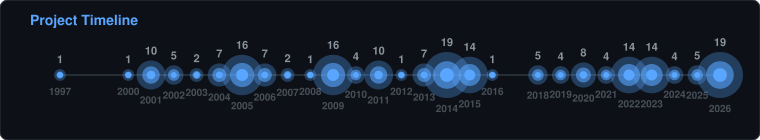

<h1 align="center">David O'Neill</h1>

<i>Engineering at Red Hat · AI-driven developer workflows · 187 public repos</i>

<h2>📈 Over the years</h2>

<h2>💻 Code by language</h2>
Size of source per language as measured by GitHub Linguist (bytes, not lines), across all public repos.

<table>
<tr>
<td width="25%"> <b>PHP</b> 112.7 MB · 43.7%</td>
<td width="25%"> <b>C#</b> 31.3 MB · 12.1%</td>
<td width="25%"> <b>JavaScript</b> 22.0 MB · 8.5%</td>
<td width="25%"> <b>TypeScript</b> 17.1 MB · 6.6%</td>
</tr><tr>
<td width="25%"> <b>Python</b> 14.4 MB · 5.6%</td>
<td width="25%"> <b>HTML</b> 12.7 MB · 4.9%</td>
<td width="25%"> <b>CSS</b> 11.5 MB · 4.5%</td>
<td width="25%"> <b>C</b> 10.5 MB · 4.1%</td>
</tr><tr>
<td width="25%"> <b>Perl</b> 9.2 MB · 3.6%</td>
<td width="25%"> <b>Java</b> 2.1 MB · 0.8%</td>
<td width="25%"> <b>Smarty</b> 2.0 MB · 0.8%</td>
<td width="25%"> <b>Shell</b> 1.9 MB · 0.7%</td>
</tr><tr>
<td width="25%"> <b>Go</b> 1.7 MB · 0.7%</td>
<td width="25%"> <b>Raku</b> 1.7 MB · 0.7%</td>
<td width="25%"> <b>Tcl</b> 1.2 MB · 0.5%</td>
<td width="25%"> <b>Classic ASP</b> 836 KB · 0.3%</td>
</tr><tr>
<td width="25%"> <b>Visual Basic .NET</b> 723 KB · 0.3%</td>
<td width="25%"> <b>TeX</b> 590 KB · 0.2%</td>
<td width="25%"> <b>Ruby</b> 488 KB · 0.2%</td>
<td width="25%"> <b>Makefile</b> 482 KB · 0.2%</td>

</tr>
</table>

<h2>✨ Featured projects</h2>
<table>
<tr>
<td align="center" valign="top" width="33%"><a href="https://github.com/dmzoneill/lidarr-youtube-downloader"> <b>lidarr-​youtube-​downloader</b></a> Lidar youtube downloader  Python ★ 77 </td>
<td align="center" valign="top" width="33%"><a href="https://github.com/dmzoneill/hevyapp-api"> <b>hevyapp-​api</b></a> API client for Hev&#121; workout tracking app  ★ 38 </td>
<td align="center" valign="top" width="33%"><a href="https://github.com/dmzoneill/strongapp-api"> <b>strongapp-​api</b></a> API client for Strong workout tracking app  Java ★ 31 </td>
</tr><tr>
<td align="center" valign="top" width="33%"><a href="https://github.com/dmzoneill/filebotpp"> <b>filebotpp</b></a> Windows Filebot wrapper with enhanced functionality  C# ★ 5 </td>
<td align="center" valign="top" width="33%"><a href="https://github.com/dmzoneill/php-binance-bot"> <b>php-​binance-​bot</b></a> Binance cryptocurrency trading bot in PHP  PHP ★ 5 </td>
<td align="center" valign="top" width="33%"><a href="https://github.com/dmzoneill/redhat-ai-workflow"> <b>redhat-​ai-​workflow</b></a> AI-​powered workflow automation tools for Red Hat engineering  Python ★ 5 </td>

</tr>
</table>

<h2>🗂 All projects (187)</h2>
<table>
<tr>
<td align="center" valign="top" width="33%"><a href="https://github.com/dmzoneill/dmzoneill"> <b>dmzoneill</b></a> Git​Hub profile repository with auto-​generated README,​…  Python  </td>
<td align="center" valign="top" width="33%"><a href="https://github.com/dmzoneill/Leecharr"> <b>Leecharr</b></a> Bit​Torrent downloader built on Sonarr/​Radarr architecture.​…  C# ★ 4 </td>
<td align="center" valign="top" width="33%"><a href="https://github.com/dmzoneill/ashtangayogacork.ie-android"> <b>ashtangayogacork.​ie-​android</b></a> Android app for Ashtanga Yoga Cork studio  Java  </td>
</tr><tr>
<td align="center" valign="top" width="33%"><a href="https://github.com/dmzoneill/ollama-proxy"> <b>ollama-​proxy</b></a> HTTP proxy for Ollama LLM API with auth and rate limiting  Go ★ 1 </td>
<td align="center" valign="top" width="33%"><a href="https://github.com/dmzoneill/aa-jenkins-scripts"> <b>aa-​jenkins-​scripts</b></a> Jenkins CI/​CD pipeline helper scripts  Shell  </td>
<td align="center" valign="top" width="33%"><a href="https://github.com/dmzoneill/lidarr-youtube-downloader"> <b>lidarr-​youtube-​downloader</b></a> Lidar youtube downloader  Python ★ 77 </td>
</tr><tr>
<td align="center" valign="top" width="33%"><a href="https://github.com/dmzoneill/bus-eireann-android-app"> <b>bus-​eireann-​android-​app</b></a> Bus Eireann real-​time bus tracker Android app  Java  </td>
<td align="center" valign="top" width="33%"><a href="https://github.com/dmzoneill/strongapp-api"> <b>strongapp-​api</b></a> API client for Strong workout tracking app  Java ★ 31 </td>
<td align="center" valign="top" width="33%"><a href="https://github.com/dmzoneill/ansible-feeditout-com"> <b>ansible-​feeditout-​com</b></a> Ansible playbooks for feeditout.​com infrastructure  Python  </td>
</tr><tr>
<td align="center" valign="top" width="33%"><a href="https://github.com/dmzoneill/aa-rdms-check"> <b>aa-​rdms-​check</b></a> RDMS (Resource and Deployment Management System) health…  Perl  </td>
<td align="center" valign="top" width="33%"><a href="https://github.com/dmzoneill/aa-app-interface-stats"> <b>aa-​app-​interface-​stats</b></a> App-​interface statistics dashboard for tracking SRE metrics  PHP  </td>
<td align="center" valign="top" width="33%"><a href="https://github.com/dmzoneill/aa-dns-checker"> <b>aa-​dns-​checker</b></a> DNS record verification and monitoring utility  Python  </td>
</tr><tr>
<td align="center" valign="top" width="33%"><a href="https://github.com/dmzoneill/ashtangayogacork.ie-assets"> <b>ashtangayogacork.​ie-​assets</b></a> Static assets for Ashtanga Yoga Cork applications   </td>
<td align="center" valign="top" width="33%"><a href="https://github.com/dmzoneill/android-digiweb-usage"> <b>android-​digiweb-​usage</b></a> Digiweb android widget  Java  </td>
<td align="center" valign="top" width="33%"><a href="https://github.com/dmzoneill/aa-concur-reimbursement-internet"> <b>aa-​concur-​reimbursement-​internet</b></a> Automated internet expense reimbursement submission for…  Python ★ 2 </td>
</tr><tr>
<td align="center" valign="top" width="33%"><a href="https://github.com/dmzoneill/ashtangayogacork.ie-wearos"> <b>ashtangayogacork.​ie-​wearos</b></a> AShtanga yoga cork wearos watch app  Kotlin  </td>
<td align="center" valign="top" width="33%"><a href="https://github.com/dmzoneill/CSIG-SW-Lab-Ticker"> <b>CSIG-​SW-​Lab-​Ticker</b></a> Software lab status ticker display for Intel CSIG  HTML  </td>
<td align="center" valign="top" width="33%"><a href="https://github.com/dmzoneill/EC-SI-DotNetAsyncServiceNow"> <b>EC-​SI-​Dot​Net​Async​Service​Now</b></a> Async Service​Now API client for .​NET  C#  </td>
</tr><tr>
<td align="center" valign="top" width="33%"><a href="https://github.com/dmzoneill/csig_onp-chef_repo"> <b>csig_​onp-​chef_​repo</b></a> Chef repository for Intel Open Network Platform  Ruby  </td>
<td align="center" valign="top" width="33%"><a href="https://github.com/dmzoneill/awx-nightlies"> <b>awx-​nightlies</b></a> AWX/​Ansible Tower nightly build monitoring and testing  Python  </td>
<td align="center" valign="top" width="33%"><a href="https://github.com/dmzoneill/github-ai-contributor"> <b>github-​ai-​contributor</b></a> A bot that contributes to projects   </td>
</tr><tr>
<td align="center" valign="top" width="33%"><a href="https://github.com/dmzoneill/CSIG-SW-SDN-NOS-CHEF"> <b>CSIG-​SW-​SDN-​NOS-​CHEF</b></a> Chef cookbooks for Intel SDN network OS configuration  Shell  </td>
<td align="center" valign="top" width="33%"><a href="https://github.com/dmzoneill/CSIG-SW-SDN-NOS-CHEF-REPO"> <b>CSIG-​SW-​SDN-​NOS-​CHEF-​REPO</b></a> Chef repository for Intel CSIG SDN network OS deployment  Ruby  </td>
<td align="center" valign="top" width="33%"><a href="https://github.com/dmzoneill/CSIG-SW-SDN-ReleasePackager"> <b>CSIG-​SW-​SDN-​Release​Packager</b></a> Release packaging tool for Intel SDN software  Perl  </td>
</tr><tr>
<td align="center" valign="top" width="33%"><a href="https://github.com/dmzoneill/CanonicalChromeExtension"> <b>Canonical​Chrome​Extension</b></a> Chrome extension for Canonical/​Ubuntu workflows  JavaScript  </td>
<td align="center" valign="top" width="33%"><a href="https://github.com/dmzoneill/docker-media-center"> <b>docker-​media-​center</b></a> Docker Compose media center stack (Plex,​ Sonarr,​ Radarr,​…  Python  </td>
<td align="center" valign="top" width="33%"><a href="https://github.com/dmzoneill/curriculum-vitae"> <b>curriculum-​vitae</b></a> Online curriculum vitae /​ resume website  HTML  </td>
</tr><tr>
<td align="center" valign="top" width="33%"><a href="https://github.com/dmzoneill/filebotpp"> <b>filebotpp</b></a> Windows Filebot wrapper with enhanced functionality  C# ★ 5 </td>
<td align="center" valign="top" width="33%"><a href="https://github.com/dmzoneill/csig_onp-chef_installer"> <b>csig_​onp-​chef_​installer</b></a> Chef installer for Intel Open Network Platform  Shell  </td>
<td align="center" valign="top" width="33%"><a href="https://github.com/dmzoneill/EC-SI-OsPostConfig"> <b>EC-​SI-​Os​Post​Config</b></a> Post-​installation OS configuration automation  Shell  </td>
</tr><tr>
<td align="center" valign="top" width="33%"><a href="https://github.com/dmzoneill/fail2counter"> <b>fail2counter</b></a> Fail2ban log analyzer and intrusion attempt counter  Python  </td>
<td align="center" valign="top" width="33%"><a href="https://github.com/dmzoneill/EC-SI-OpenStack"> <b>EC-​SI-​Open​Stack</b></a> Open​Stack deployment and configuration scripts for Intel…  Shell  </td>
<td align="center" valign="top" width="33%"><a href="https://github.com/dmzoneill/EC-SI-SisEsxi"> <b>EC-​SI-​Sis​Esxi</b></a> ESXi hypervisor management and automation scripts  Perl  </td>
</tr><tr>
<td align="center" valign="top" width="33%"><a href="https://github.com/dmzoneill/jackett-indexarr"> <b>jackett-​indexarr</b></a> Jackett indexer management tool for *arr media automation…  Python ★ 1 </td>
<td align="center" valign="top" width="33%"><a href="https://github.com/dmzoneill/DFakeSeeder"> <b>DFake​Seeder</b></a> Fake Seeder  Python ★ 1 </td>
<td align="center" valign="top" width="33%"><a href="https://github.com/dmzoneill/EC-SI-Scripts"> <b>EC-​SI-​Scripts</b></a> Collection of Intel Systems Infrastructure automation…  Perl  </td>
</tr><tr>
<td align="center" valign="top" width="33%"><a href="https://github.com/dmzoneill/EC-SI-LMT-DHCP-WWW"> <b>EC-​SI-​LMT-​DHCP-​WWW</b></a> Web interface for Intel lab DHCP management  JavaScript  </td>
<td align="center" valign="top" width="33%"><a href="https://github.com/dmzoneill/EC-SI-CfengineAnalytics"> <b>EC-​SI-​Cfengine​Analytics</b></a> Cfengine configuration management analytics dashboard  PHP  </td>
<td align="center" valign="top" width="33%"><a href="https://github.com/dmzoneill/filebot-nautilus"> <b>filebot-​nautilus</b></a> Filebot Nautilus wrapper  Python ★ 3 </td>
</tr><tr>
<td align="center" valign="top" width="33%"><a href="https://github.com/dmzoneill/csig_onp-systemd"> <b>csig_​onp-​systemd</b></a> Systemd service management for Intel Open Network Platform  C  </td>
<td align="center" valign="top" width="33%"><a href="https://github.com/dmzoneill/iLab-Puppet-Install"> <b>i​Lab-​Puppet-​Install</b></a> Puppet installation and bootstrap scripts for Intel labs  Shell  </td>
<td align="center" valign="top" width="33%"><a href="https://github.com/dmzoneill/iLab-Puppet-Config-GER-SIE-EC"> <b>i​Lab-​Puppet-​Config-​GER-​SIE-​EC</b></a> Puppet configuration for Intel Germany lab infrastructure  Puppet  </td>
</tr><tr>
<td align="center" valign="top" width="33%"><a href="https://github.com/dmzoneill/gnome-extension-publisher"> <b>gnome-​extension-​publisher</b></a> CLI tool to publish GNOME Shell extensions to…  Python  </td>
<td align="center" valign="top" width="33%"><a href="https://github.com/dmzoneill/MergedLogTimeline"> <b>Merged​Log​Timeline</b></a> Multi-​source log file timeline merger and viewer  HTML  </td>
<td align="center" valign="top" width="33%"><a href="https://github.com/dmzoneill/k8s-media-center"> <b>k8s-​media-​center</b></a> Kubernetes-​based media center deployment with Helm charts  Jinja  </td>
</tr><tr>
<td align="center" valign="top" width="33%"><a href="https://github.com/dmzoneill/github-ai-maintainer"> <b>github-​ai-​maintainer</b></a> AI-​powered Git​Hub repository maintenance automation  Shell ★ 1 </td>
<td align="center" valign="top" width="33%"><a href="https://github.com/dmzoneill/ilabprep.intel.com"> <b>ilabprep.​intel.​com</b></a> Intel i​Lab preparation portal web application  CSS  </td>
<td align="center" valign="top" width="33%"><a href="https://github.com/dmzoneill/killboard.unknown-heroes.com"> <b>killboard.​unknown-​heroes.​com</b></a> Unknown Heroes EVE Online killboard  PHP  </td>
</tr><tr>
<td align="center" valign="top" width="33%"><a href="https://github.com/dmzoneill/MattersHighLight"> <b>Matters​High​Light</b></a> Chrome extension for highlighting text on web pages  JavaScript  </td>
<td align="center" valign="top" width="33%"><a href="https://github.com/dmzoneill/hevyapp-api"> <b>hevyapp-​api</b></a> API client for Hev&#121; workout tracking app  ★ 38 </td>
<td align="center" valign="top" width="33%"><a href="https://github.com/dmzoneill/home-monitoring"> <b>home-​monitoring</b></a> home-​monitoring  Go Template  </td>
</tr><tr>
<td align="center" valign="top" width="33%"><a href="https://github.com/dmzoneill/passmate"> <b>passmate</b></a> Password management and credential helper tool  JavaScript  </td>
<td align="center" valign="top" width="33%"><a href="https://github.com/dmzoneill/sodarr-chrome-plugin"> <b>sodarr-​chrome-​plugin</b></a> Plugin for chrome that opens videos directly from sonarr…  JavaScript ★ 3 </td>
<td align="center" valign="top" width="33%"><a href="https://github.com/dmzoneill/raspberrypi-risc-assembly"> <b>raspberrypi-​risc-​assembly</b></a> Raspberry Pi ARM/​RISC assembly language programs  ActionScript  </td>
</tr><tr>
<td align="center" valign="top" width="33%"><a href="https://github.com/dmzoneill/urban-dictionary"> <b>urban-​dictionary</b></a> Simple Node.​js module that provides easy methods of…  JavaScript ★ 1 </td>
<td align="center" valign="top" width="33%"><a href="https://github.com/dmzoneill/php-binance-bot"> <b>php-​binance-​bot</b></a> Binance cryptocurrency trading bot in PHP  PHP ★ 5 </td>
<td align="center" valign="top" width="33%"><a href="https://github.com/dmzoneill/seedmagepp"> <b>seedmagepp</b></a> Torrent seeding automation and management tool  Python  </td>
</tr><tr>
<td align="center" valign="top" width="33%"><a href="https://github.com/dmzoneill/torrent-speedtest"> <b>torrent-​speedtest</b></a> Self-​hosted Bit​Torrent speed test container with built-​in…  Python  </td>
<td align="center" valign="top" width="33%"><a href="https://github.com/dmzoneill/TamperMonkey"> <b>Tamper​Monkey</b></a> Collection of Tampermonkey userscripts  JavaScript  </td>
<td align="center" valign="top" width="33%"><a href="https://github.com/dmzoneill/tado-gnome-shell-extension"> <b>tado-​gnome-​shell-​extension</b></a> GNOME Shell extension for Tado smart thermostat control  JavaScript ★ 1 </td>
</tr><tr>
<td align="center" valign="top" width="33%"><a href="https://github.com/dmzoneill/wayvox"> <b>wayvox</b></a> Wayvox: private,​ on-​device speech-​to-​text and dictation…  Python ★ 1 </td>
<td align="center" valign="top" width="33%"><a href="https://github.com/dmzoneill/webhost"> <b>webhost</b></a> Web hosting configuration and setup scripts  Shell  </td>
<td align="center" valign="top" width="33%"><a href="https://github.com/dmzoneill/wordpress-theme-intel"> <b>wordpress-​theme-​intel</b></a> Custom Word​Press theme for Intel internal sites  PHP  </td>
</tr><tr>
<td align="center" valign="top" width="33%"><a href="https://github.com/dmzoneill/iLab-Template-Scripts-devel"> <b>i​Lab-​Template-​Scripts-​devel</b></a> Development template scripts for Intel lab provisioning  Shell  </td>
<td align="center" valign="top" width="33%"><a href="https://github.com/dmzoneill/mono-gtk-gtk-foober"> <b>mono-​gtk-​gtk-​foober</b></a> GTK# audio player inspired by foobar2000  Shell  </td>
<td align="center" valign="top" width="33%"><a href="https://github.com/dmzoneill/www.linux-group-policy.com"> <b>www.​linux-​group-​policy.​com</b></a> Linux Group Policy project website  PHP  </td>
</tr><tr>
<td align="center" valign="top" width="33%"><a href="https://github.com/dmzoneill/www.feeditout.com1"> <b>www.​feeditout.​com1</b></a> Feed It Out website (version 1)  PHP  </td>
<td align="center" valign="top" width="33%"><a href="https://github.com/dmzoneill/www.davesworld.com"> <b>www.​davesworld.​com</b></a> Dave's World personal website  HTML  </td>
<td align="center" valign="top" width="33%"><a href="https://github.com/dmzoneill/forum.unknown-heroes.com"> <b>forum.​unknown-​heroes.​com</b></a> Unknown Heroes gaming community forum  PHP  </td>
</tr><tr>
<td align="center" valign="top" width="33%"><a href="https://github.com/dmzoneill/Seedarr"> <b>Seedarr</b></a> Bit​Torrent seeding simulator built on Sonarr/​Radarr…  C# ★ 2 </td>
<td align="center" valign="top" width="33%"><a href="https://github.com/dmzoneill/pling-publisher"> <b>pling-​publisher</b></a> CLI tool to publish themes and extensions to…  Python  </td>
<td align="center" valign="top" width="33%"><a href="https://github.com/dmzoneill/redhatter"> <b>redhatter</b></a> Red Hat internal tooling and utilities  Python  </td>
</tr><tr>
<td align="center" valign="top" width="33%"><a href="https://github.com/dmzoneill/seedarr.net"> <b>seedarr.​net</b></a> Website for Seedarr torrent seeding management platform  PHP  </td>
<td align="center" valign="top" width="33%"><a href="https://github.com/dmzoneill/aa-dev-prod-watcher"> <b>aa-​dev-​prod-​watcher</b></a> Development and production environment monitoring tool  TypeScript ★ 1 </td>
<td align="center" valign="top" width="33%"><a href="https://github.com/dmzoneill/BMRADashboard"> <b>BMRADashboard</b></a> BMRA (Balancing Mechanism Reporting Agent) energy data…  Tcl  </td>
</tr><tr>
<td align="center" valign="top" width="33%"><a href="https://github.com/dmzoneill/Xenith"> <b>Xenith</b></a> Xenith automation framework  Python  </td>
<td align="center" valign="top" width="33%"><a href="https://github.com/dmzoneill/securetty"> <b>securetty</b></a> Secure container-​based development environment with MCP…  Shell  </td>
<td align="center" valign="top" width="33%"><a href="https://github.com/dmzoneill/redhat-ai-workflow"> <b>redhat-​ai-​workflow</b></a> AI-​powered workflow automation tools for Red Hat engineering  Python ★ 5 </td>
</tr><tr>
<td align="center" valign="top" width="33%"><a href="https://github.com/dmzoneill/leecharr.net"> <b>leecharr.​net</b></a> Website for Leechar torrent downloader  PHP  </td>
<td align="center" valign="top" width="33%"><a href="https://github.com/dmzoneill/wpc-administrator"> <b>wpc-​administrator</b></a> WPC (Workstation Policy Control) administration tool  Visual Basic .NET  </td>
<td align="center" valign="top" width="33%"><a href="https://github.com/dmzoneill/service-controller"> <b>service-​controller</b></a> Windows service management and control panel  Visual Basic .NET  </td>
</tr><tr>
<td align="center" valign="top" width="33%"><a href="https://github.com/dmzoneill/advanced-net-sender"> <b>advanced-​net-​sender</b></a> Advanced network message sender with GUI  Visual Basic .NET  </td>
<td align="center" valign="top" width="33%"><a href="https://github.com/dmzoneill/network-utility"> <b>network-​utility</b></a> Network diagnostics and utilities toolkit  Visual Basic .NET  </td>
<td align="center" valign="top" width="33%"><a href="https://github.com/dmzoneill/clickhere-machine-configurator"> <b>clickhere-​machine-​configurator</b></a> Automated machine configuration tool for Click​Here  Visual Basic .NET  </td>
</tr><tr>
<td align="center" valign="top" width="33%"><a href="https://github.com/dmzoneill/localmini"> <b>localmini</b></a> Windows tray utility for uploading files,​ screenshots and…  C#  </td>
<td align="center" valign="top" width="33%"><a href="https://github.com/dmzoneill/asocket-example"> <b>asocket-​example</b></a> Async socket programming example in VB.​NET  Visual Basic .NET  </td>
<td align="center" valign="top" width="33%"><a href="https://github.com/dmzoneill/iLab-Puppet-Config-Global"> <b>i​Lab-​Puppet-​Config-​Global</b></a> Global Puppet configuration for Intel lab environments  Puppet  </td>
</tr><tr>
<td align="center" valign="top" width="33%"><a href="https://github.com/dmzoneill/lm051"> <b>lm051</b></a> University of Limerick LM051 Computer Systems course…  TeX  </td>
<td align="center" valign="top" width="33%"><a href="https://github.com/dmzoneill/OC-Development"> <b>OC-​Development</b></a> Open​Shift/​OKD development environment setup  Ruby  </td>
<td align="center" valign="top" width="33%"><a href="https://github.com/dmzoneill/ashtangayogacork.ie-doorpi"> <b>ashtangayogacork.​ie-​doorpi</b></a> Raspberry Pi door access system for Ashtanga Yoga Cork…  Python  </td>
</tr><tr>
<td align="center" valign="top" width="33%"><a href="https://github.com/dmzoneill/ashtangayogacork.ie-ios"> <b>ashtangayogacork.​ie-​ios</b></a> i​OS app for Ashtanga Yoga Cork studio  Swift  </td>
<td align="center" valign="top" width="33%"><a href="https://github.com/dmzoneill/CSharp-DoNothingAndExit"> <b>CSharp-​Do​Nothing​And​Exit</b></a> Minimal C# application that exits immediately — CI/​CD test…  C#  </td>
<td align="center" valign="top" width="33%"><a href="https://github.com/dmzoneill/ZorkTrek"> <b>Zork​Trek</b></a> Zork game based upon star trek  C++  </td>
</tr><tr>
<td align="center" valign="top" width="33%"><a href="https://github.com/dmzoneill/EC-SI-LMT-DHCP-SECONDARY"> <b>EC-​SI-​LMT-​DHCP-​SECONDARY</b></a> Secondary DHCP server configuration and failover  Prolog  </td>
<td align="center" valign="top" width="33%"><a href="https://github.com/dmzoneill/lm051-cs4512-imperative-programming-projects"> <b>lm051-​cs4512-​imperative-​programming-​projects</b></a> CS4512 Imperative Programming — Java assignments  Java  </td>
<td align="center" valign="top" width="33%"><a href="https://github.com/dmzoneill/Bootstack-Highlight-Monitor"> <b>Bootstack-​Highlight-​Monitor</b></a> From my days of working in canonical   </td>
</tr><tr>
<td align="center" valign="top" width="33%"><a href="https://github.com/dmzoneill/KTWD"> <b>KTWD</b></a> KTWD content management and publishing platform  PHP  </td>
<td align="center" valign="top" width="33%"><a href="https://github.com/dmzoneill/JiraStoryScraper"> <b>Jira​Story​Scraper</b></a> Jira story and issue data extraction tool  C#  </td>
<td align="center" valign="top" width="33%"><a href="https://github.com/dmzoneill/csig_onp-cfgdump"> <b>csig_​onp-​cfgdump</b></a> Configuration dump utility for Intel ONP (Open Network…  Python  </td>
</tr><tr>
<td align="center" valign="top" width="33%"><a href="https://github.com/dmzoneill/www.livingartcork.com"> <b>www.​livingartcork.​com</b></a> Living Art Cork gallery website (.​com)  Hack  </td>
<td align="center" valign="top" width="33%"><a href="https://github.com/dmzoneill/www.nemohackers.org3"> <b>www.​nemohackers.​org3</b></a> Nemo​Hackers.​org website (version 3)  PHP  </td>
<td align="center" valign="top" width="33%"><a href="https://github.com/dmzoneill/OC-PuppetClient"> <b>OC-​Puppet​Client</b></a> Puppet client configuration for Open​Shift environments  Shell  </td>
</tr><tr>
<td align="center" valign="top" width="33%"><a href="https://github.com/dmzoneill/meteor-android-widget"> <b>meteor-​android-​widget</b></a> Meteor weather data Android home screen widget  Java  </td>
<td align="center" valign="top" width="33%"><a href="https://github.com/dmzoneill/OC-Jenkins"> <b>OC-​Jenkins</b></a> Jenkins CI deployment on Open​Shift  Shell  </td>
<td align="center" valign="top" width="33%"><a href="https://github.com/dmzoneill/OC-Workspace"> <b>OC-​Workspace</b></a> Open​Shift workspace configuration and tooling  Shell  </td>
</tr><tr>
<td align="center" valign="top" width="33%"><a href="https://github.com/dmzoneill/eVacation"> <b>e​Vacation</b></a> Employee vacation and leave management system  Classic ASP  </td>
<td align="center" valign="top" width="33%"><a href="https://github.com/dmzoneill/lm051-cs4313-software-engineering-project"> <b>lm051-​cs4313-​software-​engineering-​project</b></a> CS4313 Software Engineering team project  PHP  </td>
<td align="center" valign="top" width="33%"><a href="https://github.com/dmzoneill/OC-PuppetMaster"> <b>OC-​Puppet​Master</b></a> Puppet master server setup for Open​Shift  Shell  </td>
</tr><tr>
<td align="center" valign="top" width="33%"><a href="https://github.com/dmzoneill/www.nemohackers.org4"> <b>www.​nemohackers.​org4</b></a> Nemo​Hackers.​org website (version 4)  PHP  </td>
<td align="center" valign="top" width="33%"><a href="https://github.com/dmzoneill/Linux-Group-Policy"> <b>Linux-​Group-​Policy</b></a> Group Policy implementation for Linux desktop management  HTML  </td>
<td align="center" valign="top" width="33%"><a href="https://github.com/dmzoneill/wordpress-plugin-intel-lab-tickets"> <b>wordpress-​plugin-​intel-​lab-​tickets</b></a> Word​Press plugin for Intel lab ticket management  PHP  </td>
</tr><tr>
<td align="center" valign="top" width="33%"><a href="https://github.com/dmzoneill/EC-SI-LMT-DHCP-PRIMARY"> <b>EC-​SI-​LMT-​DHCP-​PRIMARY</b></a> Primary DHCP server management for Intel lab environments  Perl  </td>
<td align="center" valign="top" width="33%"><a href="https://github.com/dmzoneill/home-helper-scripts"> <b>home-​helper-​scripts</b></a> Collection of personal home automation and helper scripts  Python  </td>
<td align="center" valign="top" width="33%"><a href="https://github.com/dmzoneill/simple-send-source"> <b>simple-​send-​source</b></a> Simple network send utility source code  Visual Basic .NET  </td>
</tr><tr>
<td align="center" valign="top" width="33%"><a href="https://github.com/dmzoneill/NPG-SW-Lab-SBar"> <b>NPG-​SW-​Lab-​SBar</b></a> Intel NPG software lab status bar monitoring widget  JavaScript  </td>
<td align="center" valign="top" width="33%"><a href="https://github.com/dmzoneill/EC-SI-SieStorage"> <b>EC-​SI-​Sie​Storage</b></a> Storage management interface for Intel lab infrastructure  JavaScript  </td>
<td align="center" valign="top" width="33%"><a href="https://github.com/dmzoneill/shannon.ir.intel.com"> <b>shannon.​ir.​intel.​com</b></a> Intel Shannon Ireland site internal web application  PHP  </td>
</tr><tr>
<td align="center" valign="top" width="33%"><a href="https://github.com/dmzoneill/clickhere-interopservices-workgroup-machines"> <b>clickhere-​interopservices-​workgroup-​machines</b></a> Workgroup machine management via COM interop services  Visual Basic .NET  </td>
<td align="center" valign="top" width="33%"><a href="https://github.com/dmzoneill/wordpress-plugin-intel-user-calendar"> <b>wordpress-​plugin-​intel-​user-​calendar</b></a> Word​Press plugin for Intel user calendar integration  PHP  </td>
<td align="center" valign="top" width="33%"><a href="https://github.com/dmzoneill/dartboard-automatic-calculator"> <b>dartboard-​automatic-​calculator</b></a> Automatic dartboard score calculator for Android  Java  </td>
</tr><tr>
<td align="center" valign="top" width="33%"><a href="https://github.com/dmzoneill/apoker-android-app"> <b>apoker-​android-​app</b></a> Android poker game application  Java  </td>
<td align="center" valign="top" width="33%"><a href="https://github.com/dmzoneill/clickhere-screensheild-delay"> <b>clickhere-​screensheild-​delay</b></a> Screensaver delay configuration utility  Visual Basic .NET  </td>
<td align="center" valign="top" width="33%"><a href="https://github.com/dmzoneill/aib-android-app"> <b>aib-​android-​app</b></a> AIB (Allied Irish Banks) account viewer Android app  Java  </td>
</tr><tr>
<td align="center" valign="top" width="33%"><a href="https://github.com/dmzoneill/apache2-virtualhost-generator"> <b>apache2-​virtualhost-​generator</b></a> Apache2 virtual host configuration generator  Visual Basic .NET  </td>
<td align="center" valign="top" width="33%"><a href="https://github.com/dmzoneill/evonews"> <b>evonews</b></a> Evolution News content management system  PHP  </td>
<td align="center" valign="top" width="33%"><a href="https://github.com/dmzoneill/clonezilla-altiris-imaging"> <b>clonezilla-​altiris-​imaging</b></a> Clonezilla to Altiris imaging migration tool  Perl  </td>
</tr><tr>
<td align="center" valign="top" width="33%"><a href="https://github.com/dmzoneill/feeditout-productions-android-app"> <b>feeditout-​productions-​android-​app</b></a> Feed It Out Productions portfolio Android app  Java  </td>
<td align="center" valign="top" width="33%"><a href="https://github.com/dmzoneill/fr00t"> <b>fr00t</b></a> Fruit-​themed desktop application  Visual Basic .NET  </td>
<td align="center" valign="top" width="33%"><a href="https://github.com/dmzoneill/internet-detect"> <b>internet-​detect</b></a> Internet connectivity detection and monitoring tool  XSLT  </td>
</tr><tr>
<td align="center" valign="top" width="33%"><a href="https://github.com/dmzoneill/apache-config-gui"> <b>apache-​config-​gui</b></a> GUI tool for Apache web server configuration  Visual Basic .NET  </td>
<td align="center" valign="top" width="33%"><a href="https://github.com/dmzoneill/gdownload"> <b>gdownload</b></a> Download manager application for Android  Java  </td>
<td align="center" valign="top" width="33%"><a href="https://github.com/dmzoneill/lm051-cs4012-data-representation-modelling-website"> <b>lm051-​cs4012-​data-​representation-​modelling-​website</b></a> CS4012 Data Representation and Modelling web project  HTML  </td>
</tr><tr>
<td align="center" valign="top" width="33%"><a href="https://github.com/dmzoneill/lm051-cs4023-operating-systems-threading"> <b>lm051-​cs4023-​operating-​systems-​threading</b></a> CS4023 Operating Systems — multi-​threading exercises in C  C  </td>
<td align="center" valign="top" width="33%"><a href="https://github.com/dmzoneill/lm051-cs4313-c--mysql-example"> <b>lm051-​cs4313-​c-​-​mysql-​example</b></a> CS4313 C++ My​SQL database integration example  C++  </td>
<td align="center" valign="top" width="33%"><a href="https://github.com/dmzoneill/lansecure"> <b>lansecure</b></a> LAN security scanner and network monitoring tool  Visual Basic .NET  </td>
</tr><tr>
<td align="center" valign="top" width="33%"><a href="https://github.com/dmzoneill/firstQt"> <b>first​Qt</b></a> First Qt C++ application — learning project  C++  </td>
<td align="center" valign="top" width="33%"><a href="https://github.com/dmzoneill/lm051-cs4146-document-architectures"> <b>lm051-​cs4146-​document-​architectures</b></a> CS4146 Document Architectures — XML/​XSLT projects  JavaScript  </td>
<td align="center" valign="top" width="33%"><a href="https://github.com/dmzoneill/lm051-cs4001-computer-applications"> <b>lm051-​cs4001-​computer-​applications</b></a> CS4001 Computer Applications coursework — Java projects  Java  </td>
</tr><tr>
<td align="center" valign="top" width="33%"><a href="https://github.com/dmzoneill/lm051-cs4115-data-structures"> <b>lm051-​cs4115-​data-​structures</b></a> CS4115 Data Structures and Algorithms in C++  C++  </td>
<td align="center" valign="top" width="33%"><a href="https://github.com/dmzoneill/mono-gtk-galarm"> <b>mono-​gtk-​galarm</b></a> GTK# alarm clock and reminder application  C#  </td>
<td align="center" valign="top" width="33%"><a href="https://github.com/dmzoneill/lm051-cs4001-computer-applications-robocode-reefer"> <b>lm051-​cs4001-​computer-​applications-​robocode-​reefer</b></a> CS4001 Robocode bot — 'Reefer' battle robot AI  Java  </td>
</tr><tr>
<td align="center" valign="top" width="33%"><a href="https://github.com/dmzoneill/lm051-cs4023-distribute-systems-shapes"> <b>lm051-​cs4023-​distribute-​systems-​shapes</b></a> CS4023 Distributed Systems — shape rendering with RMI  Java  </td>
<td align="center" valign="top" width="33%"><a href="https://github.com/dmzoneill/mono-gtk-gmx"> <b>mono-​gtk-​gmx</b></a> GTK# email client for GMX mail  C#  </td>
<td align="center" valign="top" width="33%"><a href="https://github.com/dmzoneill/mono-gtk-imdb"> <b>mono-​gtk-​imdb</b></a> GTK# IMDB movie database browser  C#  </td>
</tr><tr>
<td align="center" valign="top" width="33%"><a href="https://github.com/dmzoneill/mono-gtk-alltomp3"> <b>mono-​gtk-​alltomp3</b></a> GTK# audio converter — batch convert files to MP3  C#  </td>
<td align="center" valign="top" width="33%"><a href="https://github.com/dmzoneill/lm051-konane"> <b>lm051-​konane</b></a> Konane (Hawaiian checkers) AI game player  Java  </td>
<td align="center" valign="top" width="33%"><a href="https://github.com/dmzoneill/mono-gtk-smart"> <b>mono-​gtk-​smart</b></a> GTK# S.​M.​A.​R.​T.​ disk health monitoring tool  C#  </td>
</tr><tr>
<td align="center" valign="top" width="33%"><a href="https://github.com/dmzoneill/mono-gtk-gmpd"> <b>mono-​gtk-​gmpd</b></a> GTK# MPD (Music Player Daemon) client  C#  </td>
<td align="center" valign="top" width="33%"><a href="https://github.com/dmzoneill/mono-gtk-monomerge"> <b>mono-​gtk-​monomerge</b></a> GTK# file merge and diff tool  C#  </td>
<td align="center" valign="top" width="33%"><a href="https://github.com/dmzoneill/mono-gtk-filecleaner"> <b>mono-​gtk-​filecleaner</b></a> GTK# duplicate file finder and disk cleaner  C#  </td>
</tr><tr>
<td align="center" valign="top" width="33%"><a href="https://github.com/dmzoneill/mono-gtk-mimagemagick"> <b>mono-​gtk-​mimagemagick</b></a> GTK# Image​Magick frontend for batch image processing  C#  </td>
<td align="center" valign="top" width="33%"><a href="https://github.com/dmzoneill/mono-gtk-gsambamonitor"> <b>mono-​gtk-​gsambamonitor</b></a> GTK# Samba share monitoring tool  C#  </td>
<td align="center" valign="top" width="33%"><a href="https://github.com/dmzoneill/php-sockets"> <b>php-​sockets</b></a> PHP socket programming examples  PHP  </td>
</tr><tr>
<td align="center" valign="top" width="33%"><a href="https://github.com/dmzoneill/php-gd-playing"> <b>php-​gd-​playing</b></a> PHP GD library image manipulation experiments  PHP  </td>
<td align="center" valign="top" width="33%"><a href="https://github.com/dmzoneill/screensaver"> <b>screensaver</b></a> Custom Windows screensaver  Visual Basic .NET  </td>
<td align="center" valign="top" width="33%"><a href="https://github.com/dmzoneill/remote-process-control"> <b>remote-​process-​control</b></a> Remote process monitoring and control application  Visual Basic .NET  </td>
</tr><tr>
<td align="center" valign="top" width="33%"><a href="https://github.com/dmzoneill/sender"> <b>sender</b></a> Simple network message sender  Visual Basic .NET  </td>
<td align="center" valign="top" width="33%"><a href="https://github.com/dmzoneill/ping"> <b>ping</b></a> Visual network ping utility with GUI  Visual Basic .NET  </td>
<td align="center" valign="top" width="33%"><a href="https://github.com/dmzoneill/mysqltest"> <b>mysqltest</b></a> My​SQL database connection testing utility  Visual Basic .NET  </td>
</tr><tr>
<td align="center" valign="top" width="33%"><a href="https://github.com/dmzoneill/servicescan"> <b>servicescan</b></a> Network service discovery and port scanning utility  Makefile  </td>
<td align="center" valign="top" width="33%"><a href="https://github.com/dmzoneill/netsend"> <b>netsend</b></a> Network message sending utility  Visual Basic .NET  </td>
<td align="center" valign="top" width="33%"><a href="https://github.com/dmzoneill/mono-gtk-gtkstarter"> <b>mono-​gtk-​gtkstarter</b></a> GTK application starter template  C++  </td>
</tr><tr>
<td align="center" valign="top" width="33%"><a href="https://github.com/dmzoneill/series"> <b>series</b></a> TV series tracking and management application  PHP  </td>
<td align="center" valign="top" width="33%"><a href="https://github.com/dmzoneill/qtclub"> <b>qtclub</b></a> QT Club community website  PHP  </td>
<td align="center" valign="top" width="33%"><a href="https://github.com/dmzoneill/ultimetable-android-app"> <b>ultimetable-​android-​app</b></a> University timetable viewer Android app  Java  </td>
</tr><tr>
<td align="center" valign="top" width="33%"><a href="https://github.com/dmzoneill/synologydownloadassistant.com"> <b>synologydownloadassistant.​com</b></a> Website for Synology Download Assistant browser extension  CSS  </td>
<td align="center" valign="top" width="33%"><a href="https://github.com/dmzoneill/jira-creator"> <b>jira-​creator</b></a> helps in the creation of stories,​issues,​epics,​bugs,​spikes  Python ★ 4 </td>
<td align="center" valign="top" width="33%"><a href="https://github.com/dmzoneill/synology-download-assistance-chrome-extension"> <b>synology-​download-​assistance-​chrome-​extension</b></a> Chrome extension for sending downloads to Synology NAS  JavaScript  </td>
</tr><tr>
<td align="center" valign="top" width="33%"><a href="https://github.com/dmzoneill/www.antoyau.com"> <b>www.​antoyau.​com</b></a> Antoyau.​com website  PHP  </td>
<td align="center" valign="top" width="33%"><a href="https://github.com/dmzoneill/www.feeditout.com-2008"> <b>www.​feeditout.​com-​2008</b></a> Feed It Out website (2008 archive)  HTML  </td>
<td align="center" valign="top" width="33%"><a href="https://github.com/dmzoneill/serials"> <b>serials</b></a> Serial number and license key management system  PHP  </td>
</tr><tr>
<td align="center" valign="top" width="33%"><a href="https://github.com/dmzoneill/wpc-client"> <b>wpc-​client</b></a> WPC (Workstation Policy Control) client agent  Visual Basic .NET  </td>
<td align="center" valign="top" width="33%"><a href="https://github.com/dmzoneill/www.biosed.org"> <b>www.​biosed.​org</b></a> Bio​Sed.​org website  CSS  </td>
<td align="center" valign="top" width="33%"><a href="https://github.com/dmzoneill/www.corkcountybadminton.com"> <b>www.​corkcountybadminton.​com</b></a> Cork County Badminton Association website  HTML  </td>
</tr><tr>
<td align="center" valign="top" width="33%"><a href="https://github.com/dmzoneill/www.corrosioncomputers.org"> <b>www.​corrosioncomputers.​org</b></a> Corrosion Computers website  HTML  </td>
<td align="center" valign="top" width="33%"><a href="https://github.com/dmzoneill/www.clickherecork.com"> <b>www.​clickherecork.​com</b></a> Click​Here Cork IT services website  PHP  </td>
<td align="center" valign="top" width="33%"><a href="https://github.com/dmzoneill/www.feeditout.com"> <b>www.​feeditout.​com</b></a> Feed It Out productions website  PHP  </td>
</tr><tr>
<td align="center" valign="top" width="33%"><a href="https://github.com/dmzoneill/www.livingartcork.net"> <b>www.​livingartcork.​net</b></a> Living Art Cork gallery website (.​net)  Hack  </td>
<td align="center" valign="top" width="33%"><a href="https://github.com/dmzoneill/www.nemohackers.org1"> <b>www.​nemohackers.​org1</b></a> Nemo​Hackers.​org website (version 1)  Perl  </td>
<td align="center" valign="top" width="33%"><a href="https://github.com/dmzoneill/www.nemohackers.org2"> <b>www.​nemohackers.​org2</b></a> Nemo​Hackers.​org website (version 2)  PHP  </td>
</tr><tr>
<td align="center" valign="top" width="33%"><a href="https://github.com/dmzoneill/www.realmoflight.org"> <b>www.​realmoflight.​org</b></a> Realm of Light website  PHP  </td>
<td align="center" valign="top" width="33%"><a href="https://github.com/dmzoneill/bin"> <b>bin</b></a> Personal utility scripts and command-​line tools  Python  </td>
<td align="center" valign="top" width="33%"><a href="https://github.com/dmzoneill/www.megalan.net"> <b>www.​megalan.​net</b></a> Mega​LAN gaming event website  PHP  </td>
</tr><tr>
<td align="center" valign="top" width="33%"><a href="https://github.com/dmzoneill/www.tadpole.tk"> <b>www.​tadpole.​tk</b></a> Tadpole.​tk website  JavaScript  </td>
<td align="center" valign="top" width="33%"><a href="https://github.com/dmzoneill/www.feeditout.com2"> <b>www.​feeditout.​com2</b></a> Feed It Out website (version 2)  PHP  </td>
<td align="center" valign="top" width="33%"><a href="https://github.com/dmzoneill/skills"> <b>skills</b></a> Skills and competencies reference  ★ 2 </td>
</tr><tr>
<td align="center" valign="top" width="33%"><a href="https://github.com/dmzoneill/bashrc"> <b>bashrc</b></a> Personal bash configuration and shell customizations  Shell  </td>

</tr>
</table>

<h3>📝 Gists (24)</h3>

<table>
<tr><td>📄</td><td><a href="https://gist.github.com/dmzoneill/cf2d484d13bdfe689586d984af2105bd">Bash hints that suggest modern alternatives to legacy Linux commands</a> modern-hints.sh</td><td align="right">2026-10-20</td></tr>
<tr><td>📄</td><td><a href="https://gist.github.com/dmzoneill/93eef357f1e61f8d337a348fa5c180f0">XDock test badges</a> xdock-coverage.json, xdock-integration-tests.json, xdock-unit-tests.json</td><td align="right">2026-10-26</td></tr>
<tr><td>📄</td><td><a href="https://gist.github.com/dmzoneill/6b234c35e25d3f586f68db8e79591d65">XDock test badges</a> gistfile0.txt, xdock-integration-tests.json</td><td align="right">2026-07-12</td></tr>
<tr><td>📄</td><td><a href="https://gist.github.com/dmzoneill/3f59c2b525578a7543e2f4d6914c2d77">AAP Contract Validation - Cross-Cluster Bridge Architecture</a> aap-contract-validation-architecture.md</td><td align="right">2026-06-26</td></tr>
<tr><td>📄</td><td><a href="https://gist.github.com/dmzoneill/c992016e6ae2a29985302ac664f5a15b">AI-generated full spine MRI analysis report (not a medical diagnosis)</a> AI.md</td><td align="right">2026-10-20</td></tr>
<tr><td>📄</td><td><a href="https://gist.github.com/dmzoneill/8bc6af47fd734f1389a6a9981d7268a1">Claude Code session reviewing a Siemens full spine MRI DICOM export</a> gistfile1.txt</td><td align="right">2026-10-20</td></tr>
<tr><td>📄</td><td><a href="https://gist.github.com/dmzoneill/87698993c18d9bab7a7fe6def4166481">AAP Billing Validation — Three-Way Cross-Reference Pipeline Diagram</a> billing-validation-pipeline.md</td><td align="right">2026-06-10</td></tr>
<tr><td>📄</td><td><a href="https://gist.github.com/dmzoneill/fbb3b83719785f3fc86b0607d7aba23c">Mailias: self-hosted email alias forwarding service architecture and design</a> CLAUDE.md</td><td align="right">2026-10-20</td></tr>
<tr><td>📄</td><td><a href="https://gist.github.com/dmzoneill/64a18fe75765d2a7b672361b0c871150">Crude oil price monitor with technical analysis indicators in Python</a> gistfile1.txt</td><td align="right">2026-10-20</td></tr>
<tr><td>📄</td><td><a href="https://gist.github.com/dmzoneill/6f88cc5cb2720168b0f4bd32a1068d22">Opinionated Slop Manager: multi-agent code review skill for smells and AI slop</a> OpinionatedSlopManager.txt</td><td align="right">2026-10-20</td></tr>
<tr><td>📄</td><td><a href="https://gist.github.com/dmzoneill/af4a56c98fe185a9b14abba35bb5c29b">Complete Guide: Multi-Instance Ollama Setup with NPU, Intel GPU, and NVIDIA GPU</a> Complete Guide: Multi-Instance Ollama Setup with NPU, Intel GPU, and NVIDIA GPU.md</td><td align="right">2026-10-23</td></tr>
<tr><td>📄</td><td><a href="https://gist.github.com/dmzoneill/da7e49a55b7bd4ded318b82309c1bfd7">Cloudflare email routing script that creates random anagram alias addresses</a> gistfile1.txt</td><td align="right">2026-10-20</td></tr>
<tr><td>📄</td><td><a href="https://gist.github.com/dmzoneill/441f88a5c73136b8128c252ad84100b3">Tampermonkey script to clean up Slack and Jira messages with ChatGPT</a> slack-tapermoneky.js</td><td align="right">2026-10-22</td></tr>
<tr><td>📄</td><td><a href="https://gist.github.com/dmzoneill/80bfef9603448c33df02ce0aa98fcd59">Python script that writes a git commit message from the diff using OpenAI</a> fancy-git-commit.sh</td><td align="right">2026-10-20</td></tr>
<tr><td>📄</td><td><a href="https://gist.github.com/dmzoneill/7c9159b30950621c065791e7861be174">Python GTK4 ColumnView Sorting and Binding</a> gistfile1.txt</td><td align="right">2025-06-09</td></tr>
<tr><td>📄</td><td><a href="https://gist.github.com/dmzoneill/19a4fbd799f1e5bcc050ddb4b0a65403">Python GTK4 ColumnView with clickable column header sorting</a> gistfile1.txt</td><td align="right">2026-10-20</td></tr>
<tr><td>📄</td><td><a href="https://gist.github.com/dmzoneill/74033698f65a5a1539d686452a73dce8">Python GTK4 ColumnView with per-column string and numeric sorters</a> gistfile1.txt</td><td align="right">2026-10-20</td></tr>
<tr><td>📄</td><td><a href="https://gist.github.com/dmzoneill/497746f38c5786c96e8859f1131667af">git diff of awx-operator between releases 2.15.0 and 2.16.0</a> gistfile1.txt</td><td align="right">2026-10-20</td></tr>
<tr><td>📄</td><td><a href="https://gist.github.com/dmzoneill/67a908fb949dc95bbbf02f0446a07f0a">PHP script that writes a name from the URL onto a JPEG image with GD</a> gistfile1.txt</td><td align="right">2026-10-20</td></tr>
<tr><td>📄</td><td><a href="https://gist.github.com/dmzoneill/d13d88b16d4d0aa90cb108a00ab3cf01">Linux sysctl and ethtool tuning for 10GbE networking</a> 10gb.txt</td><td align="right">2026-10-20</td></tr>
<tr><td>📄</td><td><a href="https://gist.github.com/dmzoneill/55f6eb89dcdedd6c8bb2e5cffbab6caa">DNS Policy Routing via Raspberry Pi VPN Gateway</a> RPI rc.local, resolv.conf</td><td align="right">2023-01-25</td></tr>
<tr><td>📄</td><td><a href="https://gist.github.com/dmzoneill/575ba9c32375c41cb1041e9064de0678">Synology 108tb limit bypass</a> Synology 108tb limit bypass.txt</td><td align="right">2026-06-15</td></tr>
<tr><td>📄</td><td><a href="https://gist.github.com/dmzoneill/cbc75e502dbe2b78651f68d6320b714a">Automation Analytics Postgres pg_stat_activity active queries dump</a> AA active queries.txt</td><td align="right">2026-10-20</td></tr>
<tr><td>📄</td><td><a href="https://gist.github.com/dmzoneill/faaa84782eaed4d2dc28ad55c19119ee">PHP Paypal Instant Payment Notification</a> PHP Paypal Instant Payment Notification.txt</td><td align="right">2023-01-25</td></tr>

</table>

<h3>🟢 Issues (24)</h3>

<table>
<tr><td>🟢</td><td><a href="https://github.com/dmzoneill/lidarr-youtube-downloader/issues/21">Issue with Lidarr recognizing downloaded audio and incorrect metadata in Jellyfin</a> dmzoneill/lidarr-youtube-downloader#21</td><td align="right">2026-10-19</td></tr>
<tr><td>🟢</td><td><a href="https://github.com/dmzoneill/ansible-feeditout-com/issues/456">[ALERT] PrometheusTargetDown — </a> dmzoneill/ansible-feeditout-com#456</td><td align="right">2026-09-28</td></tr>
<tr><td>🟢</td><td><a href="https://github.com/dmzoneill/ansible-feeditout-com/issues/454">[ALERT] SystemdUnitFailed — </a> dmzoneill/ansible-feeditout-com#454</td><td align="right">2026-09-21</td></tr>
<tr><td>🟢</td><td><a href="https://github.com/dmzoneill/ansible-feeditout-com/issues/455">[ALERT] HighTcpConnections — </a> dmzoneill/ansible-feeditout-com#455</td><td align="right">2026-09-15</td></tr>
<tr><td>🟢</td><td><a href="https://github.com/dmzoneill/securetty/issues/175">OTEL instrumentation for agent containers and MCP servers</a> dmzoneill/securetty#175</td><td align="right">2026-08-10</td></tr>
<tr><td>🟢</td><td><a href="https://github.com/dmzoneill/securetty/issues/166">egress: No feedback on what domains/IPs were added or changed</a> dmzoneill/securetty#166</td><td align="right">2026-08-10</td></tr>
<tr><td>🟢</td><td><a href="https://github.com/dmzoneill/securetty/issues/162">skill: SECURETTY_MCP_SKILLS_DIR not configured in env generation</a> dmzoneill/securetty#162</td><td align="right">2026-08-10</td></tr>
<tr><td>🟢</td><td><a href="https://github.com/dmzoneill/securetty/issues/161">init: Creates .skillsaw.yaml but skillsaw tool not in agent manifests</a> dmzoneill/securetty#161</td><td align="right">2026-08-10</td></tr>
<tr><td>🟢</td><td><a href="https://github.com/dmzoneill/securetty/issues/157">eval: promptfoo fetched via npx, bypasses delayed ingestion security</a> dmzoneill/securetty#157</td><td align="right">2026-08-10</td></tr>
<tr><td>🟢</td><td><a href="https://github.com/dmzoneill/securetty/issues/143">config: Validation bug in set command and incomplete profile system</a> dmzoneill/securetty#143</td><td align="right">2026-08-10</td></tr>
<tr><td>🟢</td><td><a href="https://github.com/dmzoneill/securetty/issues/141">plugin: No execution mechanism — installed plugins are inert</a> dmzoneill/securetty#141</td><td align="right">2026-08-10</td></tr>
<tr><td>🟢</td><td><a href="https://github.com/dmzoneill/securetty/issues/142">jira-triage: Codeable action creates branch but never creates MR/PR</a> dmzoneill/securetty#142</td><td align="right">2026-08-10</td></tr>
<tr><td>🟢</td><td><a href="https://github.com/dmzoneill/securetty/issues/139">run-remote: Incomplete implementation — no volumes, secrets, or image validation</a> dmzoneill/securetty#139</td><td align="right">2026-08-10</td></tr>
<tr><td>🟢</td><td><a href="https://github.com/dmzoneill/ansible-feeditout-com/issues/183">Create comprehensive disaster recovery runbook</a> dmzoneill/ansible-feeditout-com#183</td><td align="right">2026-07-27</td></tr>
<tr><td>🟢</td><td><a href="https://github.com/dmzoneill/ansible-feeditout-com/issues/185">Add backup encryption verification and secondary backup target</a> dmzoneill/ansible-feeditout-com#185</td><td align="right">2026-07-26</td></tr>
<tr><td>🟢</td><td><a href="https://github.com/dmzoneill/ansible-feeditout-com/issues/184">Evaluate nftables migration from legacy iptables</a> dmzoneill/ansible-feeditout-com#184</td><td align="right">2026-07-26</td></tr>
<tr><td>🟢</td><td><a href="https://github.com/dmzoneill/ansible-feeditout-com/issues/186">Add incremental backup strategy to reduce backup time and storage</a> dmzoneill/ansible-feeditout-com#186</td><td align="right">2026-07-26</td></tr>
<tr><td>🟢</td><td><a href="https://github.com/dmzoneill/ansible-feeditout-com/issues/165">Add backup integrity verification and restore testing</a> dmzoneill/ansible-feeditout-com#165</td><td align="right">2026-07-26</td></tr>
<tr><td>🟢</td><td><a href="https://github.com/dmzoneill/lidarr-youtube-downloader/issues/25">Most releases found are missing tracks</a> dmzoneill/lidarr-youtube-downloader#25</td><td align="right">2026-03-30</td></tr>
<tr><td>🟢</td><td><a href="https://github.com/dmzoneill/DFakeSeeder/issues/15">Question about sessions and events.</a> dmzoneill/DFakeSeeder#15</td><td align="right">2026-03-06</td></tr>
<tr><td>🟢</td><td><a href="https://github.com/dmzoneill/lidarr-youtube-downloader/issues/23">Track Format &amp; FFMPEG not adding metadata</a> dmzoneill/lidarr-youtube-downloader#23</td><td align="right">2026-02-19</td></tr>
<tr><td>🟢</td><td><a href="https://github.com/dmzoneill/lidarr-youtube-downloader/issues/28">Stuck?</a> dmzoneill/lidarr-youtube-downloader#28</td><td align="right">2026-02-18</td></tr>
<tr><td>🟢</td><td><a href="https://github.com/dmzoneill/tado-gnome-shell-extension/issues/2">Got this message after trying to enable it (Gnome45):</a> dmzoneill/tado-gnome-shell-extension#2</td><td align="right">2026-02-18</td></tr>
<tr><td>🟢</td><td><a href="https://github.com/dmzoneill/lidarr-youtube-downloader/issues/29">[FR] Only search for missing songs from artists with a given tag</a> dmzoneill/lidarr-youtube-downloader#29</td><td align="right">2026-02-18</td></tr>

</table>

<h3>🔀 Pull Requests (0)</h3>

<table>

</table>

<h3>⚡ Recent Activity (38)</h3>

<table>
<tr><td>⬆️</td><td><a href="https://github.com/dmzoneill/lansecure/commits/main">Pushed to main</a> dmzoneill/lansecure</td><td align="right">2026-10-27 11:39 UTC</td></tr>
<tr><td>⬆️</td><td><a href="https://github.com/dmzoneill/wordpress-plugin-intel-lab-tickets/commits/main">Pushed to main</a> dmzoneill/wordpress-plugin-intel-lab-tickets</td><td align="right">2026-10-27 11:27 UTC</td></tr>
<tr><td>⬆️</td><td><a href="https://github.com/dmzoneill/firstQt/commits/main">Pushed to main</a> dmzoneill/firstQt</td><td align="right">2026-10-27 11:38 UTC</td></tr>
<tr><td>⬆️</td><td><a href="https://github.com/dmzoneill/ashtangayogacork.ie-ios/commits/main">Pushed to main</a> dmzoneill/ashtangayogacork.ie-ios</td><td align="right">2026-10-27 11:24 UTC</td></tr>
<tr><td>⬆️</td><td><a href="https://github.com/dmzoneill/ashtangayogacork.ie-doorpi/commits/main">Pushed to main</a> dmzoneill/ashtangayogacork.ie-doorpi</td><td align="right">2026-10-27 11:24 UTC</td></tr>
<tr><td>⬆️</td><td><a href="https://github.com/dmzoneill/lm051/commits/main">Pushed to main</a> dmzoneill/lm051</td><td align="right">2026-10-27 11:24 UTC</td></tr>
<tr><td>⬆️</td><td><a href="https://github.com/dmzoneill/remote-process-control/commits/main">Pushed to main</a> dmzoneill/remote-process-control</td><td align="right">2026-10-27 11:42 UTC</td></tr>
<tr><td>⬆️</td><td><a href="https://github.com/dmzoneill/Linux-Group-Policy/commits/docs/add-readme">Pushed to docs/add-readme</a> dmzoneill/Linux-Group-Policy</td><td align="right">2026-10-27 11:19 UTC</td></tr>
<tr><td>⬆️</td><td><a href="https://github.com/dmzoneill/gdownload/commits/main">Pushed to main</a> dmzoneill/gdownload</td><td align="right">2026-10-27 11:38 UTC</td></tr>
<tr><td>⬆️</td><td><a href="https://github.com/dmzoneill/network-utility/commits/main">Pushed to main</a> dmzoneill/network-utility</td><td align="right">2026-10-27 11:14 UTC</td></tr>
<tr><td>⬆️</td><td><a href="https://github.com/dmzoneill/EC-SI-LMT-DHCP-PRIMARY/commits/main">Pushed to main</a> dmzoneill/EC-SI-LMT-DHCP-PRIMARY</td><td align="right">2026-10-27 11:27 UTC</td></tr>
<tr><td>⬆️</td><td><a href="https://github.com/dmzoneill/feeditout-productions-android-app/commits/main">Pushed to main</a> dmzoneill/feeditout-productions-android-app</td><td align="right">2026-10-27 11:33 UTC</td></tr>
<tr><td>⬆️</td><td><a href="https://github.com/dmzoneill/clickhere-screensheild-delay/commits/main">Pushed to main</a> dmzoneill/clickhere-screensheild-delay</td><td align="right">2026-10-27 11:33 UTC</td></tr>
<tr><td>⬆️</td><td><a href="https://github.com/dmzoneill/aib-android-app/commits/main">Pushed to main</a> dmzoneill/aib-android-app</td><td align="right">2026-10-27 11:32 UTC</td></tr>
<tr><td>⬆️</td><td><a href="https://github.com/dmzoneill/dmzoneill/commits/dependabot-exclude-puppet-bundler">Pushed to dependabot-exclude-puppet-bundler</a> dmzoneill/dmzoneill</td><td align="right">2026-10-27 11:20 UTC</td></tr>
<tr><td>⬆️</td><td><a href="https://github.com/dmzoneill/OC-Development/commits/main">Pushed to main</a> dmzoneill/OC-Development</td><td align="right">2026-10-27 11:20 UTC</td></tr>
<tr><td>⬆️</td><td><a href="https://github.com/dmzoneill/meteor-android-widget/commits/docs/add-readme">Pushed to docs/add-readme</a> dmzoneill/meteor-android-widget</td><td align="right">2026-10-27 11:19 UTC</td></tr>
<tr><td>⬆️</td><td><a href="https://github.com/dmzoneill/dmzoneill/commits/main">Pushed to main</a> dmzoneill/dmzoneill</td><td align="right">2026-10-27 11:27 UTC</td></tr>
<tr><td>⬆️</td><td><a href="https://github.com/dmzoneill/EC-SI-SieStorage/commits/main">Pushed to main</a> dmzoneill/EC-SI-SieStorage</td><td align="right">2026-10-27 11:27 UTC</td></tr>
<tr><td>⬆️</td><td><a href="https://github.com/dmzoneill/home-helper-scripts/commits/main">Pushed to main</a> dmzoneill/home-helper-scripts</td><td align="right">2026-10-27 11:26 UTC</td></tr>
<tr><td>⬆️</td><td><a href="https://github.com/dmzoneill/NPG-SW-Lab-SBar/commits/main">Pushed to main</a> dmzoneill/NPG-SW-Lab-SBar</td><td align="right">2026-10-27 11:25 UTC</td></tr>
<tr><td>⬆️</td><td><a href="https://github.com/dmzoneill/CSharp-DoNothingAndExit/commits/main">Pushed to main</a> dmzoneill/CSharp-DoNothingAndExit</td><td align="right">2026-10-27 11:24 UTC</td></tr>
<tr><td>⬆️</td><td><a href="https://github.com/dmzoneill/lm051-cs4313-software-engineering-project/commits/docs/add-readme">Pushed to docs/add-readme</a> dmzoneill/lm051-cs4313-software-engineering-project</td><td align="right">2026-10-27 11:19 UTC</td></tr>
<tr><td>⬆️</td><td><a href="https://github.com/dmzoneill/service-controller/commits/main">Pushed to main</a> dmzoneill/service-controller</td><td align="right">2026-10-27 11:14 UTC</td></tr>
<tr><td>⬆️</td><td><a href="https://github.com/dmzoneill/mono-gtk-gsambamonitor/commits/main">Pushed to main</a> dmzoneill/mono-gtk-gsambamonitor</td><td align="right">2026-10-27 11:40 UTC</td></tr>
<tr><td>⬆️</td><td><a href="https://github.com/dmzoneill/internet-detect/commits/main">Pushed to main</a> dmzoneill/internet-detect</td><td align="right">2026-10-27 11:38 UTC</td></tr>
<tr><td>⬆️</td><td><a href="https://github.com/dmzoneill/clonezilla-altiris-imaging/commits/main">Pushed to main</a> dmzoneill/clonezilla-altiris-imaging</td><td align="right">2026-10-27 11:33 UTC</td></tr>
<tr><td>⬆️</td><td><a href="https://github.com/dmzoneill/OC-Workspace/commits/main">Pushed to main</a> dmzoneill/OC-Workspace</td><td align="right">2026-10-27 11:26 UTC</td></tr>
<tr><td>⬆️</td><td><a href="https://github.com/dmzoneill/OC-PuppetMaster/commits/main">Pushed to main</a> dmzoneill/OC-PuppetMaster</td><td align="right">2026-10-27 11:26 UTC</td></tr>
<tr><td>⬆️</td><td><a href="https://github.com/dmzoneill/csig_onp-cfgdump/commits/main">Pushed to main</a> dmzoneill/csig_onp-cfgdump</td><td align="right">2026-10-27 11:25 UTC</td></tr>
<tr><td>⬆️</td><td><a href="https://github.com/dmzoneill/Bootstack-Highlight-Monitor/commits/main">Pushed to main</a> dmzoneill/Bootstack-Highlight-Monitor</td><td align="right">2026-10-27 11:24 UTC</td></tr>
<tr><td>⬆️</td><td><a href="https://github.com/dmzoneill/mono-gtk-gmx/commits/main">Pushed to main</a> dmzoneill/mono-gtk-gmx</td><td align="right">2026-10-27 11:40 UTC</td></tr>
<tr><td>⬆️</td><td><a href="https://github.com/dmzoneill/mono-gtk-gmpd/commits/main">Pushed to main</a> dmzoneill/mono-gtk-gmpd</td><td align="right">2026-10-27 11:40 UTC</td></tr>
<tr><td>⬆️</td><td><a href="https://github.com/dmzoneill/lm051-cs4001-computer-applications/commits/main">Pushed to main</a> dmzoneill/lm051-cs4001-computer-applications</td><td align="right">2026-10-27 11:39 UTC</td></tr>
<tr><td>⬆️</td><td><a href="https://github.com/dmzoneill/mono-gtk-filecleaner/commits/main">Pushed to main</a> dmzoneill/mono-gtk-filecleaner</td><td align="right">2026-10-27 11:40 UTC</td></tr>
<tr><td>⬆️</td><td><a href="https://github.com/dmzoneill/lm051-cs4313-c--mysql-example/commits/main">Pushed to main</a> dmzoneill/lm051-cs4313-c--mysql-example</td><td align="right">2026-10-27 11:39 UTC</td></tr>
<tr><td>⬆️</td><td><a href="https://github.com/dmzoneill/lm051-cs4023-operating-systems-threading/commits/main">Pushed to main</a> dmzoneill/lm051-cs4023-operating-systems-threading</td><td align="right">2026-10-27 11:39 UTC</td></tr>
<tr><td>⬆️</td><td><a href="https://github.com/dmzoneill/asocket-example/commits/main">Pushed to main</a> dmzoneill/asocket-example</td><td align="right">2026-10-27 11:14 UTC</td></tr>

</table>

<h3>🏢 Work over on</h3>

<ul><li><a href="https://github.com/dmzoneill-forks">My forks</a></li>
<li><a href="https://github.com/RedHatInsights">RedHat Insights</a></li>
<li><a href="https://github.com/app-sre">AppSRE</a></li>
<li><a href="https://github.com/Redhat-forks">Redhat forks</a></li>
<li><a href="https://github.com/Canonical-forks">Canonical forks</a></li>
<li><a href="https://github.com/Intel-forks">Intel forks</a></li>
</ul>

