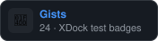
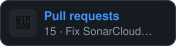
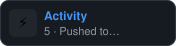

<h1 align="center">David O'Neill</h1>

<i>Engineering at Red Hat · AI-driven developer workflows · {repo_count} public repos</i>

📝 <b>Gists</b> · {gist_count} · latest {gist_latest_rel}

<table>
<gists><tr><td>{icon}</td><td><a href="{url}">{title}</a> <code>{tag}</code></td><td align="right">{rel}</td></tr></gists>
</table>

🟢 <b>Issues</b> · {issue_count} · latest {issue_latest_rel}

<table>
<issues><tr><td>{icon}</td><td><a href="{url}">{title}</a> <code>{tag}</code></td><td align="right">{rel}</td></tr></issues>
</table>

🔀 <b>Pull requests</b> · {pr_count} · latest {pr_latest_rel}

<table>
<prs><tr><td>{icon}</td><td><a href="{url}">{title}</a> <code>{tag}</code></td><td align="right">{rel}</td></tr></prs>
</table>

⚡ <b>Activity</b> · {activity_count} · latest {activity_latest_rel}

<table>
<recent><tr><td>{icon}</td><td><a href="{url}">{title}</a> <code>{tag}</code></td><td align="right">{rel}</td></tr></recent>
</table>

<h3>🏢 Forks &amp; work orgs</h3>

<orgs> </orgs>

<h2>📈 Over the years</h2>

<h2>💻 Code by language</h2>
Size of source per language as measured by GitHub Linguist (bytes, not lines), across all public repos.

<table>
<tr>
<langs><td width="20%">{lang_dot} <b>{language}</b> {bytes_human} · {percent}% </td></langs>
</tr>
</table>

<h2>✨ Featured projects</h2>
<table>
<tr>
<featured><td align="center" valign="top" width="33%"><a href="{html_url}"> <b>{display_name}</b></a> {description} {lang_dot}{language} {stars} · {year}{badge_html}</td></featured>
</tr>
</table>

<h2>🗂 All projects ({repo_count})</h2>
<years><h3>📅 {section_year} · {section_count}</h3>
<table>
<tr>
<repos><td align="center" valign="top" width="33%"><a href="{html_url}"> <b>{display_name}</b></a> {description} {lang_dot}{language} {stars} · {year}{badge_html}</td></repos>
</tr>
</table></years>
